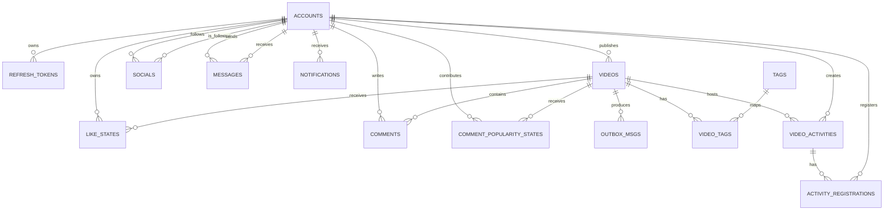

# Agora 数据模型设计

## 1. 说明

本项目使用 GORM AutoMigrate 创建表结构。模型之间以 ID 字段建立逻辑关联，当前未声明 MySQL 外键；关联完整性由 Service 层校验、唯一索引和事务保证。这样可以避免异步消费和批量操作被数据库级联约束阻塞，但删除或修改关联数据时需要由应用层负责一致性处理。

除 `video_activities` 与 `activity_registrations` 显式指定表名外，表名由 GORM 按模型名复数化生成。

## 2. 实体关系

`socials`、`messages`、`notifications` 各自包含两个面向 `accounts` 的角色字段，例如关注者/被关注者或发送者/接收者。`video_tags` 是视频与话题的关联表。

## 3. 账号与鉴权

### accounts

| 字段 | 类型/约束 | 说明 |
| --- | --- | --- |
| `id` | uint, PK | 账号 ID |
| `username` | varchar(191), UNIQUE | 登录名与公开视频作者名 |
| `password` | varchar(255) | bcrypt 密码哈希，不序列化到响应 |
| `avatar_url` | varchar(512) | 头像地址 |
| `bio` | varchar(255) | 个人简介 |
| `follower_count` | bigint, NOT NULL, default 0 | 粉丝总数；由关注/取关事务维护，用于关注流推拉模式判断 |

### refresh_tokens

| 字段 | 类型/约束 | 说明 |
| --- | --- | --- |
| `id` | uint, PK | 主键 |
| `token_hash` | varchar(64), UNIQUE | Refresh Token 的 SHA-256 哈希 |
| `user_id` | uint, INDEX | 所属账号 |
| `device_id` / `device_name` / `ip_address` | 可空 | 设备与来源信息 |
| `status` | tinyint, INDEX | `1` 有效，`0` 已撤销 |
| `revoked_reason` | varchar(32), 可空 | 撤销原因，如轮换、登出、改密或异常复用 |
| `expire_at` | datetime, NOT NULL | 过期时间 |
| `created_at` / `last_used_at` | datetime | 创建与最后使用时间 |

索引：`uk_token_hash(token_hash)`；`idx_user_id_status(user_id, status)`。

## 4. 视频与话题

### videos

| 字段 | 类型/约束 | 说明 |
| --- | --- | --- |
| `id` | uint, PK | 视频 ID |
| `author_id` | uint, INDEX | 发布账号 |
| `username` | varchar(255) | 发布时的作者名快照 |
| `title` / `description` | varchar(255) | 标题与描述 |
| `play_url` / `cover_url` | varchar(255), NOT NULL | 视频与封面地址 |
| `create_time` | datetime, INDEX | 发布时间 |
| `likes_count` | bigint, default 0 | 点赞计数 |
| `popularity` | bigint, default 0 | 热度计数 |

索引：`idx_videos_author_id(author_id)`、`idx_videos_create_time(create_time DESC)`、`idx_videos_likes_count_id(likes_count DESC, id DESC)`、`idx_videos_popularity_time_id(popularity DESC, create_time DESC, id DESC)`。

### tags 与 video_tags

| 表 | 核心字段 | 约束与用途 |
| --- | --- | --- |
| `tags` | `id`、`name` | `name` 唯一；保存从标题和描述提取的 `#话题` |
| `video_tags` | `id`、`video_id`、`tag_id` | 多对多关联；`video_id`、`tag_id` 分别建立索引 |

### outbox_msgs

| 字段 | 类型/约束 | 说明 |
| --- | --- | --- |
| `id` | uint, PK | 主键 |
| `event_type` | varchar(50), INDEX | `video_published`、`like_intent`、`like_applied`、`comment_intent`、`comment_applied` |
| `payload` | JSON | 待投递事件完整内容 |
| `status` | varchar(50), INDEX | 待投递状态 |
| `retry_count` / `next_retry_at` | int / datetime | Poller 发布失败后的重试状态 |
| `create_time` | datetime | 创建时间 |

视频发布事务同时写入 `videos`、`outbox_msgs` 和话题关系；Outbox 轮询器收到 RabbitMQ Publisher Confirm ACK 后才删除该记录。发布失败、NACK 或确认超时都会保留记录等待重试，因此时间线消费者按至少一次投递处理。

### 时间线消息重试拓扑

时间线重试状态不写入 MySQL，而是放在 AMQP Header `x-retry-count`。Worker 每次投递到延迟队列前复制原 Header 并递增该值；`x-death` 用于记录 Broker 的死信路径和排查信息，不作为业务重试计数。

| 组件 | 配置 | 作用 |
| --- | --- | --- |
| 业务队列 | `timeline.queue` | 消费视频时间线事件；配置死信 Exchange 和死信 routing key |
| 重试 Exchange | `timeline.retry.events` | 使用 direct 路由将消息送入对应延迟队列 |
| 延迟队列 | `1s` / `10s` / `60s` 三档 TTL | 消息过期后回流 `timeline.events` 的 `timeline.publish` |
| 死信队列 | `timeline.queue.dlq` | 保存重试耗尽后的最终失败消息 |

## 5. 互动、私信与通知

| 表 | 核心字段 | 关键约束/索引 |
| --- | --- | --- |
| `like_states` | `account_id`、`video_id`、`is_liked`、`version`、`applied_version` | `(account_id, video_id)` 唯一；`version` 是 API 为每次 Intent 分配的递增版本，`applied_version` 是 LikeIntentWorker 已处理到的最新版本，`is_liked` 保存最终点赞状态 |
| `comments` | `source_event_id`、`author_id`、`username`、`video_id`、`content`、`created_at` | `source_event_id` 唯一，防止评论 Intent 重投重复插入；作者、用户名、视频分别有索引 |
| `comment_popularity_states` | `author_id`、`video_id` | `(author_id, video_id)` 唯一；同一用户仅首次评论该视频贡献热度 |
| `socials` | `follower_id`、`vlogger_id` | 联合唯一索引 `idx_social_follower_vlogger`；两个单列索引用于查询粉丝和关注列表；与 `accounts.follower_count` 在同一事务维护 |
| `messages` | `from_id`、`to_id`、`content`、`is_read`、`created_at` | `idx_message_from(from_id)`、`idx_message_to(to_id)` |
| `notifications` | `recipient_id`、`sender_id`、`type`、`target_id`、`content`、`source_event_id`、`is_read`、`created_at` | `recipient_id` 有索引；`source_event_id` 唯一，用于至少一次投递下的通知去重 |

`like_states` 通过版本号处理同一点赞关系的重复和迟到 Intent：Worker 只接受比 `applied_version` 更新的 Intent，状态未变化时仅推进处理版本，真正变化时再更新视频计数并产生 Applied 事件。评论以 `source_event_id` 去重。点赞和评论通知使用来源事件 ID 去重。

## 6. 视频限额活动

### video_activities

| 字段 | 类型/约束 | 说明 |
| --- | --- | --- |
| `id` | uint, PK | 活动 ID |
| `video_id` / `creator_id` | uint, INDEX | 所属视频与创建者 |
| `title` / `description` | varchar(100) / varchar(500) | 活动信息 |
| `quota` | bigint, NOT NULL | 总名额 |
| `remaining_quota` | bigint, NOT NULL | MySQL 中的最终剩余名额 |
| `start_at` / `end_at` | datetime, INDEX | 报名时间窗口 |
| `created_at` | datetime | 创建时间 |

### activity_registrations

| 字段 | 类型/约束 | 说明 |
| --- | --- | --- |
| `id` | uint, PK | 主键 |
| `activity_id` / `account_id` | uint, NOT NULL | 活动与报名账号 |
| `event_id` | varchar(64), UNIQUE | RabbitMQ 报名事件 ID |
| `created_at` | datetime | 报名落库时间 |

索引：联合唯一索引 `uk_video_activity_account(activity_id, account_id)` 保证一人一单；`event_id` 唯一索引用于事件去重。

Redis 保存活动的瞬时预扣状态，MySQL 的 `remaining_quota` 与 `activity_registrations` 是最终账本。具体的预扣、异步落库和失败补偿流程见 [架构设计](架构设计.md)。
