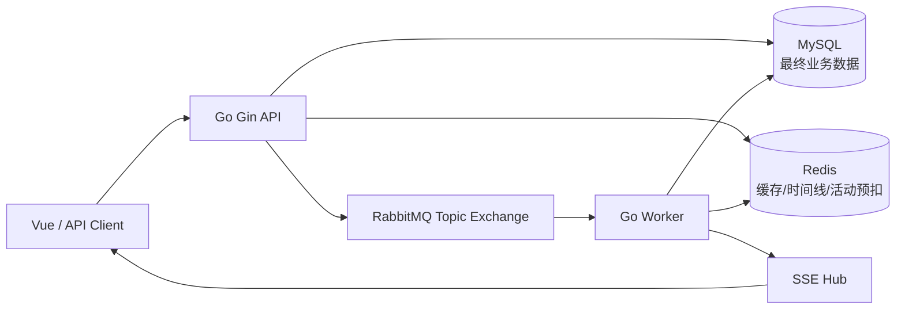
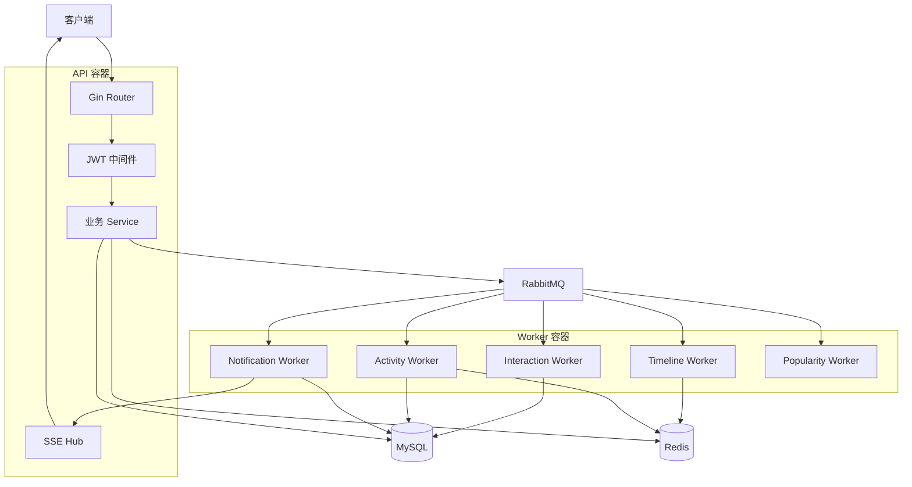
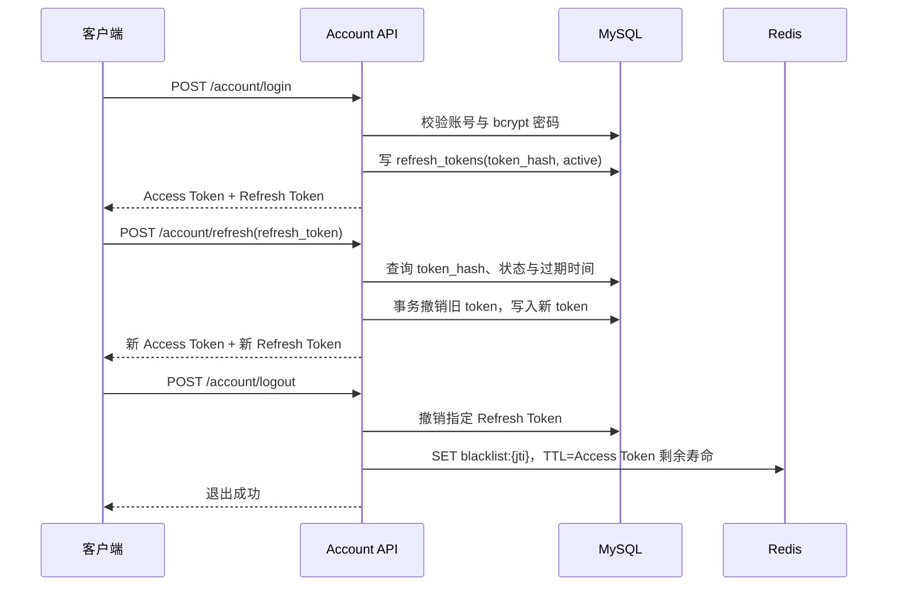
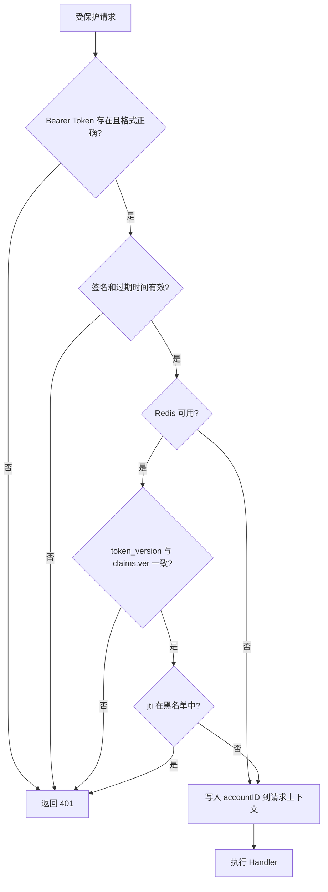
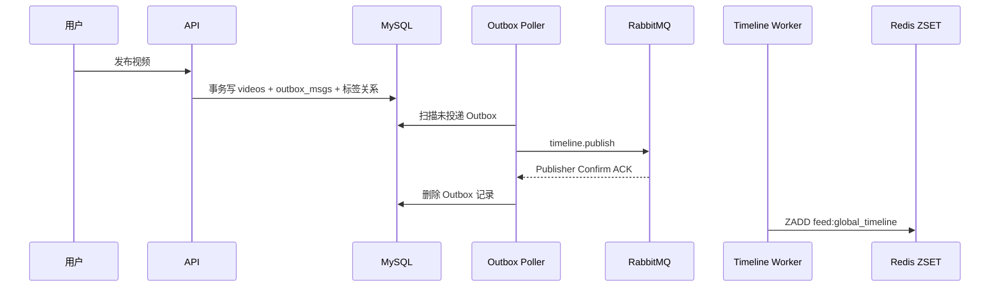
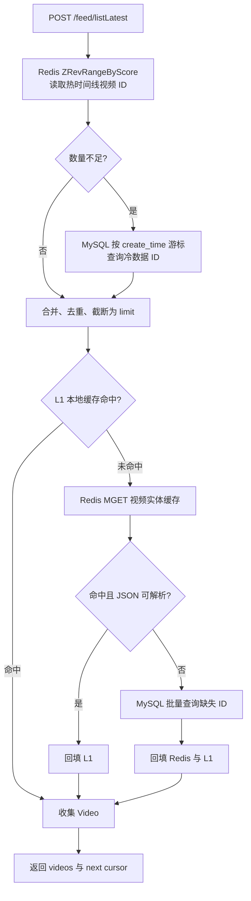
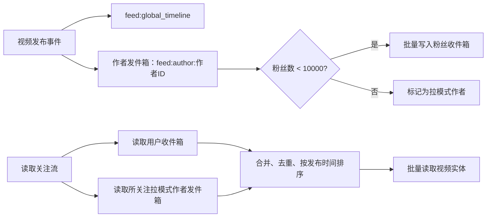
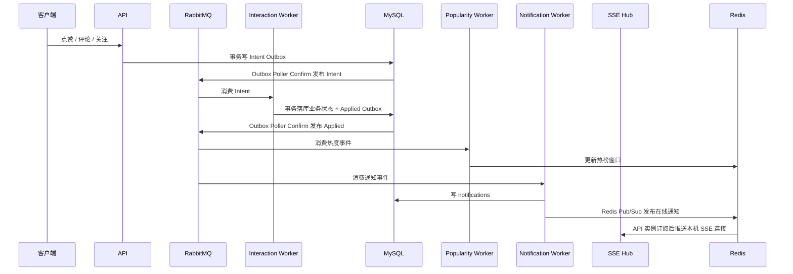
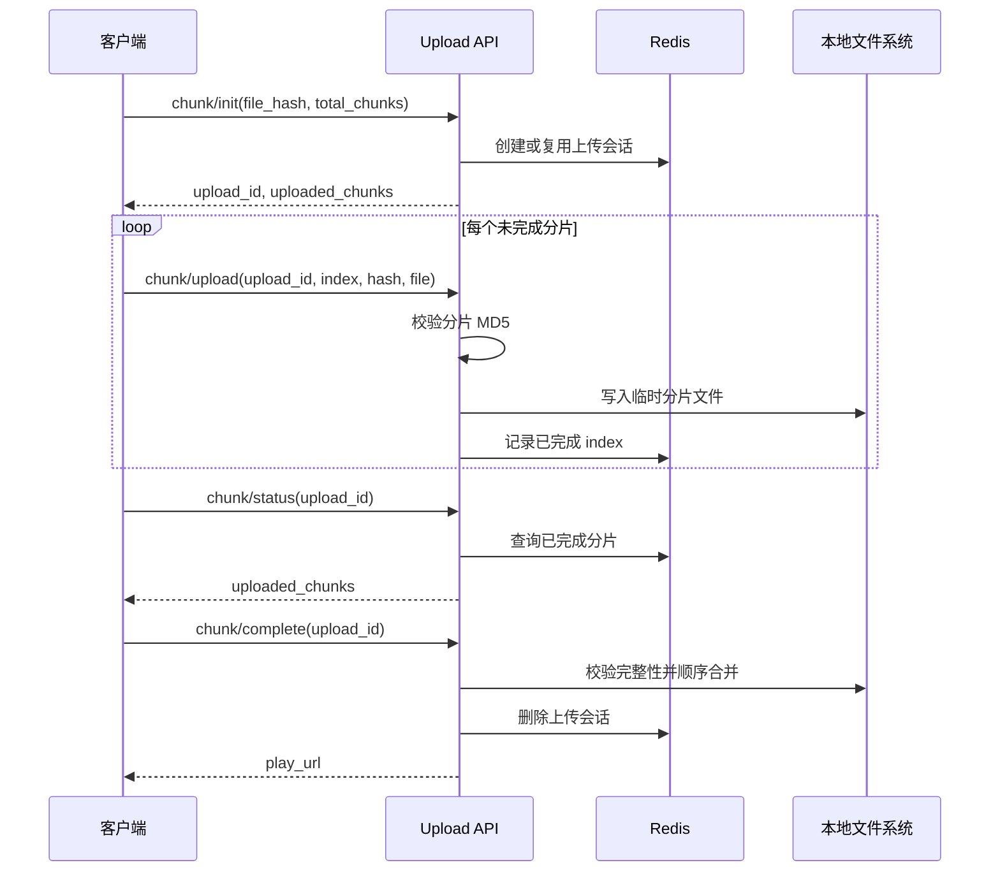
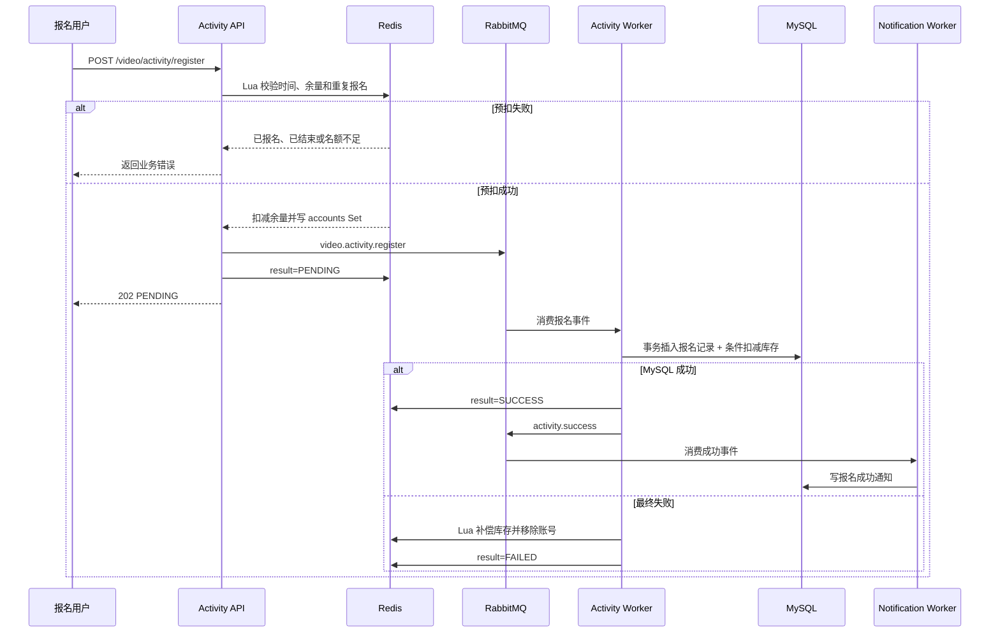

# Agora 架构设计

## 1. 项目定位

Agora 是一个支持视频、多图和文章的内容分发与互动系统，围绕规则分发、高频互动和最终一致性设计，覆盖最新流、热门流、关注流、可靠异步写入、实时通知和限额活动报名等后端问题。

## 2. 架构

进程职责：

| 进程 | 职责 |
| --- | --- |
| API | HTTP 参数绑定、JWT 鉴权、同步查询、Redis 原子操作、事务写入 Outbox、SSE 长连接管理 |
| Worker | 消费互动、热度、时间线、活动报名与通知事件，异步更新 MySQL/Redis |
| MySQL | Account、Content、ContentAsset、Like、Comment、Social、Notification、Outbox、Activity 等最终持久化数据 |
| Redis | 限流、Token 版本/黑名单、内容缓存、时间线 ZSET、热榜、分块上传会话、活动余量与报名集合 |
| RabbitMQ | 将慢写与通知从 API 请求链路拆出；使用 Topic Exchange 按 routing key 分发 |

后端业务模块遵循 Handler → Service → Repository：Handler 负责 HTTP，Service 编排业务规则与缓存/MQ，Repository 只负责数据库访问。

### 2.1 组件关系

数据表、索引和逻辑关系见 [数据模型设计](数据模型设计.md)。

## 3. 核心链路

### 3.1 登录、刷新与撤销

1. 登录校验账号密码，生成 15 分钟 Access Token 和随机 Refresh Token。
2. Refresh Token 只保存哈希值到 `refresh_tokens`，有效期 7 天；Access Token 带 `account_id`、用户名、版本号 `ver` 与唯一 `jti`。
3. 刷新时在事务中将旧 Refresh Token 标记为 `revoked_reason=rotated` 并写入新记录，即 Rotation。若该旧 Token 后续再次出现，系统会判定为异常复用，撤销该账号全部 Refresh Token 并递增 Token Version。
4. JWT 中间件先验签和检查过期时间，再从 Redis 校验 `token_version:<uid>` 与 `blacklist:<jti>`：改密码会递增版本使全端旧 Access Token 失效；登出把当前 `jti` 加黑名单。
5. 改名会重新签发 Access Token，因为 token 内包含用户名。

边界：Redis 异常时当前实现选择记录日志后放行，以避免 Redis 故障导致全站 401；代价是黑名单和版本撤销在这段时间不生效。Refresh Token 的撤销状态仍在 MySQL。

#### 登录与 Refresh Token Rotation

#### JWT 鉴权中间件

### 3.2 视频发布与 Outbox 时间线

Outbox 的作用是解决“视频已经提交到 MySQL，但 API 在发 MQ 前崩溃”的双写不一致：视频和待投递事件在同一个 MySQL 事务提交，轮询器可在之后补发。轮询器收到 RabbitMQ Publisher Confirm 的 ACK 后才删除记录；超时、NACK 或发布失败都会保留记录等待重试。确认成功后、删除记录前进程崩溃时可能再次投递，因此 Timeline Worker 以 `video_id` 作为 ZSET member 写入，重复消费保持幂等。

#### 时间线消费重试与死信隔离

Timeline Worker 只有在全局时间线、作者发件箱、推拉模式标记和普通作者 fan-out 等关键步骤成功后才 ACK。关键步骤失败时，Worker 将原消息和递增的 `x-retry-count` 发布到专用重试 Exchange，并等待 Publisher Confirm；收到 ACK 后才确认原消息。

| 重试次数 | 延迟队列 | 延迟后回流目标 |
| --- | --- | --- |
| 1 | `timeline.retry.1s.queue` | `timeline.events` / `timeline.publish` |
| 2 | `timeline.retry.10s.queue` | `timeline.events` / `timeline.publish` |
| 3 | `timeline.retry.60s.queue` | `timeline.events` / `timeline.publish` |

延迟队列使用 `x-message-ttl` 等待，TTL 到期后通过 DLX 自动回流时间线队列。第四次消费仍失败时，Worker 执行 `Nack(requeue=false)`；Broker 将消息路由到 `timeline.queue.dlq`。重试消息投递失败时，原消息回队，Worker 关闭消费和重试发布 Channel 后重连，避免使用失效 Channel 空转。

### 3.3 Feed 读取

- `ListLatest`：Redis `feed:global_timeline` 保存最近热数据 ID，时间更早的数据回查 MySQL 后拼接，使用时间游标继续翻页。
- `GetVideoByIDs`：先查进程内 L1 缓存（短 TTL），再用 Redis `MGET` 查 L2，剩余 ID 批量查 MySQL（L3），最后回填前两层。
- `ListByPopularity`：热度事件按分钟分桶写入 ZSET；点赞权重为 1、评论权重为 2，查询时以 30 分钟为半衰期加权合并最近 60 个桶，生成带 `as_of` 的快照后再按 offset 翻页，避免用户翻页过程中榜单变化导致顺序跳动。
- `ListLikesCount`：MySQL 按 `likes_count, id` 的复合游标分页，避免传统 offset 深分页。
- `ListByFollowing`：采用推拉结合。普通作者发布时将视频推入粉丝收件箱；粉丝数达到 10000 的作者只写作者发件箱，读侧从用户收件箱和所关注大 V 的发件箱各取候选、去重并按发布时间排序。关注作者 ID 以 Redis Set 做 Cache Aside 缓存，MySQL 关注关系仍是事实来源。

最新流不提供严格的全局顺序保证：冷热切换和并发发布时，基于时间游标的聚合列表可能在边界处重复或遗漏。若需要严格顺序，需要引入全局序列号或稳定快照机制。

#### 最新流与视频三级缓存

#### 关注流推拉结合

作者发件箱和用户收件箱均保留最近 1000 条。普通作者的 fan-out 按关系表主键游标分批，每批使用 Redis Pipeline；任一批失败时让时间线事件重试。拉模式避免大 V 发布时向海量粉丝写入 Redis，代价是其粉丝读取关注流时需要合并少量作者发件箱。

### 3.4 点赞、评论、关注与通知

点赞和评论写请求先在 MySQL 事务中记录 Intent Outbox，API 随后返回。Outbox Poller 在收到 Publisher Confirm 后删除待投递记录；LikeIntentWorker 与 Comment Worker 消费 Intent，在事务中更新业务状态、视频计数与已生效事件 Outbox。Applied 事件再分别驱动热度和通知。关注保持独立的异步事件链路。

点赞 Intent 带有同一 `(user_id, video_id)` 关系内单调递增的 `version`。LikeIntentWorker 锁定对应 `like_states` 行，只处理大于 `applied_version` 的消息；迟到或重投的旧 Intent 被跳过。因此连续点赞、取消点赞的消息即使重试或乱序到达，最终状态仍以最新版本为准。视频的 `likes_count` 与热度更新保留在 Worker，避免 API 请求直接竞争同一视频的公共计数行。

这种设计缩短了 API 请求中的持久化工作，适合写入可以最终一致的互动场景。代价是客户端需要接受短暂延迟，读接口可能在 Worker 消费前看不到最新状态。

### 3.5 分片上传

1. 客户端以文件哈希调用 `chunk/init`；Redis 保存上传会话和已传分片索引。
2. 每个 `chunk/upload` 校验分片 MD5 后写入本地临时目录。
3. `chunk/status` 返回已完成块，客户端可在中断后续传。
4. `chunk/complete` 检查完整性，按序合并为视频文件，删除临时块与 Redis 会话。

Redis 存的是“上传协调状态”，不是文件内容；当前单机文件系统方案适合开发/单实例。要横向扩容上传服务，需要将文件改存对象存储或共享存储。

### 3.6 限额活动报名

活动由视频作者创建，`video_activities` 保存总名额、剩余名额和时间窗口。创建后在 Redis 初始化：

| Key | 类型 | 作用 |
| --- | --- | --- |
| `v1:video_activity:{id}` | Hash | `remaining_quota`、`start_at`、`end_at` |
| `v1:video_activity:{id}:accounts` | Set | 已成功预扣名额的账号 ID |
| `v1:video_activity:{id}:result:{account}` | String | `PENDING` / `SUCCESS` / `FAILED` |

报名的完整过程：

1. API 调用 Redis Lua 脚本，在一个原子操作内检查活动存在、是否开始/结束、用户是否已报名、余量是否大于零；成功则 `SADD` 用户并 `HINCRBY -1` 预扣库存。
2. API 发布 `video.activity.register` 并立即返回 `PENDING`，将高并发请求从 MySQL 写路径削峰。
3. Activity Worker 消费事件，在 MySQL 事务中插入报名记录，并用 `remaining_quota > 0` 条件更新扣减数据库库存。
4. MySQL 成功后发送 `activity.success`，Notification Worker 写报名成功通知；查询报名结果返回 `SUCCESS`。
5. 如果最终落库失败，Worker 执行 Lua 补偿：移除报名用户、恢复 Redis 余量并写 `FAILED`。

Lua 已经在 Redis 单线程中原子执行，因此多个 API 实例共用同一 Redis 时仍能保证 Redis 侧一人一单和不超额，不需要额外 `SETNX` 分布式锁。MySQL 的唯一索引和条件扣减负责最终兜底。

当前限制：事件发布使用持久化消息，但未接入 publisher confirm；活动创建成功但 Redis 初始化失败时不会自动清理数据库记录。

## 4. 消息设计

| Exchange | Routing Key | 消费者 | 目的 |
| --- | --- | --- | --- |
| `timeline.events` | `timeline.publish` | Timeline Worker | 将已发布视频写入 Feed 时间线 |
| `timeline.retry.events` | `timeline.retry.1s` / `10s` / `60s` | 延迟重试队列 | 延迟后回流时间线业务队列 |
| `dlx.events` | `timeline.queue` | `timeline.queue.dlq` | 保留时间线最终失败消息 |
| `like.intent.events` | `like.intent` | LikeIntentWorker | 消费点赞或取消点赞意图并裁决最终状态 |
| `like.applied.events` | `like.applied` | Popularity / Notification Worker | 点赞真实生效后的热度和通知 |
| `comment.intent.events` | `comment.intent` | Comment Worker | 消费发布或删除评论意图 |
| `comment.applied.events` | `comment.applied` | Popularity / Notification Worker | 评论真实发布后的热度和通知 |
| `social.events` | `social.follow` / `social.unfollow` | Social / Notification Worker | 同步粉丝收件箱与关注通知 |
| `popularity.events` | `popularity.update` | Popularity Worker | 更新热榜窗口 |
| `activity.events` | `activity.register` | Activity Worker | 异步落库活动报名 |
| `activity.events` | `activity.success` | Notification Worker | 产生报名成功通知 |

活动消费者会重试数据库写入；队列配置死信交换机。消费者设计按至少一次投递理解，因此数据库写入必须具备幂等约束。

## 5. 部署与可观测性

`docker compose up -d --build` 默认运行 MySQL、Redis、RabbitMQ、API、Worker。API 的 `/healthz` 由 Compose 健康检查使用；上传目录挂载为 named volume。API 和 Worker 使用同一 Dockerfile 的不同 target，最终仍是两个独立容器/进程。

本地开发可以只把三种中间件放入 Docker，API 与 Worker 用 `go run` 启动。配置文件路径由 `CONFIG_PATH` 决定，环境变量的优先级高于 JSON 配置文件。

当前可观察手段：容器健康状态、API/Worker 日志、RabbitMQ 管理台、MySQL/Redis 查询，以及本地 pprof 配置。性能测试会记录接口延迟、错误率、吞吐量、容器 CPU/内存、Redis 命中率和 RabbitMQ 队列积压。

## 6. 已知限制

- 视频发布、点赞和评论使用事务 Outbox 与 Publisher Confirm；活动和关注事件仍使用各自的发布方式。
- Redis 故障时 JWT 中间件降级为只验签，黑名单与 token 版本不参与校验。
- 关注和活动通知当前未使用来源事件唯一键；极端重投时可能产生重复通知。
- 上传文件保存在本地卷中，API 多实例部署需要共享存储或对象存储。
- 热榜按时间窗口聚合，刷新周期内的热点变更不会立即反映到已有快照。

## 7. 后续演进

1. 为活动和关注事件补充 Outbox、Publisher Confirm 与失败重试。
2. 为关注和活动通知引入来源事件唯一键。
3. 将上传文件迁移到对象存储，并调整分片上传会话的存储策略。
4. 补充 OpenAPI 文档、集成测试和性能测试报告。
